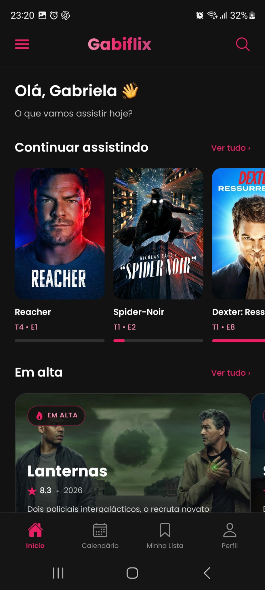
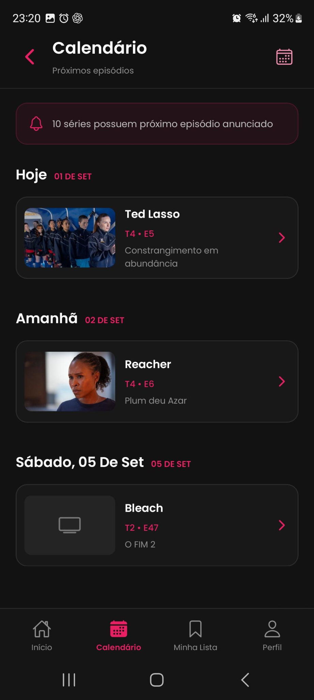
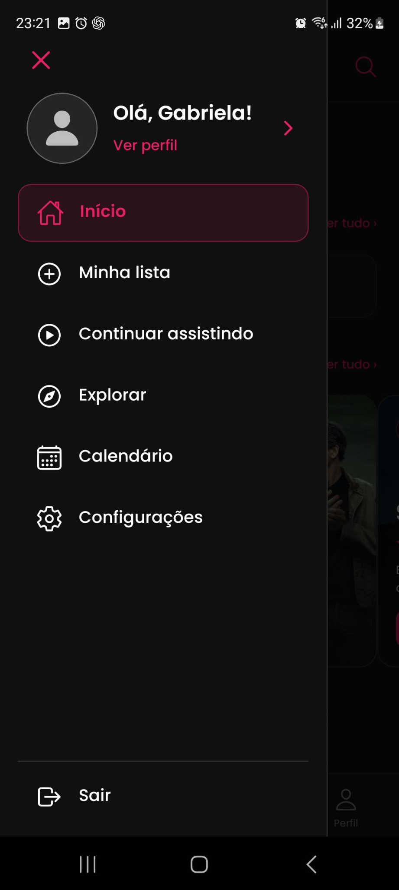
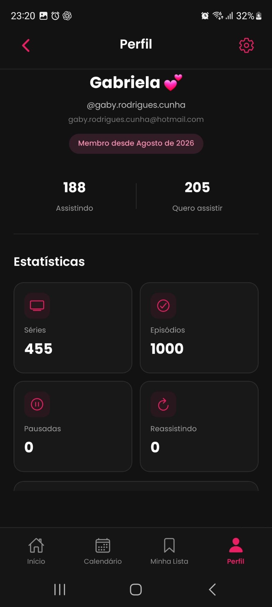
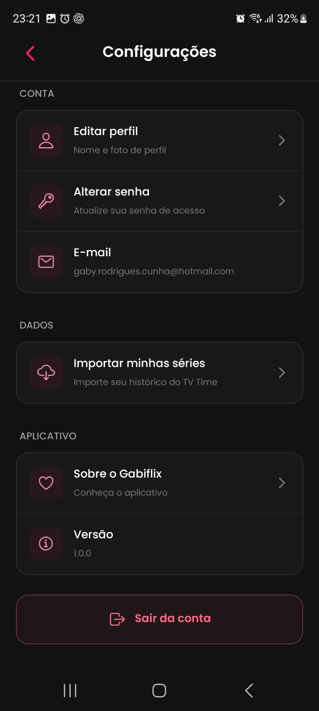

# GABIFLIX — Acompanhamento de Séries e Animes

Aplicativo desenvolvido para organizar e acompanhar **séries e animes**, reunindo descobertas, lista pessoal e progresso dos episódios em um só lugar.

O projeto permite consultar informações sobre os títulos, registrar episódios assistidos e acompanhar os próximos lançamentos, com uma identidade visual em tons de rosa e fundo escuro.

## Acesse o projeto

🔗 [Repositório do Gabiflix](https://github.com/gabyrodriguescunha-ui/Gabiflix)

## Sobre o aplicativo

O Gabiflix foi criado para facilitar a organização dos títulos que você acompanha ou deseja assistir.

A proposta é reunir o catálogo, o histórico e o progresso de cada pessoa em uma experiência personalizada. As informações das séries são consultadas no TMDB, enquanto a conta e os registros do usuário são armazenados no Supabase.

## Telas do aplicativo

Conheça algumas telas do Gabiflix.

| Login | Início | Calendário |
| :---: | :---: | :---: |
|  |  |  |

| Menu lateral | Perfil | Configurações |
| :---: | :---: | :---: |
|  |  |  |

## Funcionalidades

- Cadastro e login com e-mail e senha;
- Persistência da sessão do usuário;
- Alteração e recuperação de senha;
- Edição de nome e foto de perfil;
- Catálogo de séries populares, em alta e lançamentos recentes;
- Busca por título;
- Filtros por gênero, período e provedor de streaming;
- Ordenação dos resultados;
- Página de detalhes com informações e elenco;
- Consulta de temporadas e episódios;
- Lista pessoal de séries;
- Organização por status de acompanhamento;
- Marcação e desmarcação de episódios assistidos;
- Indicação do próximo episódio;
- Histórico de episódios assistidos;
- Calendário de próximos episódios;
- Estatísticas no perfil;
- Importação de dados do TV Time em JSON ou ZIP;
- Menu lateral de navegação;
- Modais personalizados de confirmação.

## Telas

### Início

Apresenta títulos para descobrir e acompanhar, com acesso às listagens de séries em alta, populares e lançamentos recentes.

### Busca

Permite pesquisar títulos e explorar o catálogo por gênero, período e provedor de streaming no Brasil.

Também oferece ordenação por títulos mais recentes, mais populares e melhor avaliados.

### Detalhes da série

Reúne informações da série, imagens, elenco e acesso às temporadas. A partir dessa tela, é possível incluir o título na lista pessoal.

### Temporadas e episódios

Exibe os episódios de cada temporada e permite registrar ou remover a marcação de assistido.

### Minha lista

Organiza os títulos salvos de acordo com o acompanhamento do usuário:

| Status | Finalidade |
| --- | --- |
| Quero assistir | Títulos para começar depois |
| Assistindo | Séries em acompanhamento |
| Pausada | Títulos com acompanhamento interrompido temporariamente |
| Finalizada | Títulos marcados como finalizados |
| Abandonada | Séries que o usuário deixou de acompanhar |
| Reassistindo | Títulos que estão sendo vistos novamente |

### Continuar assistindo

Apresenta o progresso das séries e indica o próximo episódio, incluindo situações em que é necessário aguardar a estreia.

### Calendário

Exibe os próximos episódios das séries em acompanhamento, organizados por data com base nas informações disponíveis no TMDB.

### Perfil e configurações

Apresenta os dados da conta e estatísticas dos títulos e episódios. Permite editar nome e foto, alterar a senha, acessar a importação do TV Time e sair da conta.

## Tecnologias

- React Native;
- React;
- TypeScript;
- Expo SDK 54;
- Expo Router;
- Supabase;
- TMDB API;
- AsyncStorage;
- Expo Image Picker;
- Expo Document Picker;
- Expo Linear Gradient;
- Expo Vector Icons;
- JSZip.

As versões e dependências completas estão no arquivo `package.json`.

## Organização dos estilos

Os estilos foram separados das telas para facilitar a manutenção do projeto.

A estrutura reúne:

- Estilos específicos de cada tela;
- Estilos dos componentes reutilizáveis;
- Tema compartilhado;
- Configuração visual de cores e elementos da interface.

Os arquivos ficam na pasta `styles/` e junto aos componentes que possuem seus próprios estilos.

## Conceitos aplicados

- Componentização;
- Tipagem com TypeScript;
- Hooks do React;
- Navegação baseada em arquivos;
- Consumo de API REST;
- Operações assíncronas;
- Autenticação de usuários;
- Persistência de sessão;
- Integração com banco de dados;
- Upload de imagens;
- Manipulação de datas;
- Leitura e processamento de arquivos JSON e ZIP;
- Separação de responsabilidades entre telas, serviços e estilos;
- Tratamento de carregamento, erros e confirmações.

## Estrutura do projeto

| Caminho | Responsabilidade |
| --- | --- |
| `app/` | Telas e rotas do aplicativo |
| `app/serie/` | Detalhes de séries |
| `app/temporadas/` | Temporadas e episódios |
| `components/` | Cabeçalho, cards, menu lateral e modal de confirmação |
| `services/` | Catálogo, lista pessoal, episódios e importação |
| `lib/supabase.ts` | Configuração do cliente Supabase |
| `styles/` | Estilos das telas e tema |
| `types/` | Tipos utilizados pelo projeto |
| `assets/images/` | Recursos visuais do aplicativo |
| `app.json` | Configurações do Expo |
| `eas.json` | Perfis de build |
| `package.json` | Dependências e scripts |

## Como executar o projeto

Tenha Node.js e npm compatíveis com o Expo SDK 54 e um dispositivo ou emulador configurado.

Clone o repositório:

```bash
git clone https://github.com/gabyrodriguescunha-ui/Gabiflix.git
```

Entre na pasta:

```bash
cd Gabiflix
```

Instale as dependências:

```bash
npm ci
```

Crie um arquivo `.env` na raiz do projeto:

```dotenv
EXPO_PUBLIC_SUPABASE_URL=sua_url_do_supabase
EXPO_PUBLIC_SUPABASE_KEY=sua_chave_publica_do_supabase
EXPO_PUBLIC_TMDB_TOKEN=seu_token_de_leitura_do_tmdb
```

Após configurar os serviços descritos abaixo, inicie o aplicativo:

```bash
npm start
```

Escolha a opção de execução disponível no terminal do Expo.

### Outros comandos

| Comando | Finalidade |
| --- | --- |
| `npm run android` | Iniciar com a opção Android |
| `npm run ios` | Iniciar com a opção iOS |
| `npm run web` | Iniciar a versão web |
| `npm run lint` | Executar a análise de código |

O simulador de iOS depende de macOS e Xcode. A execução em cada plataforma exige o ambiente correspondente.

## Supabase

O Supabase é utilizado para autenticação, armazenamento da lista pessoal, histórico dos episódios e fotos de perfil.

Para executar o projeto com uma nova conta, configure:

- Autenticação por e-mail e senha;
- Tabela `minha_lista`, conforme os campos utilizados em `services/minha-lista.service.ts`;
- Tabela `episodios_assistidos`, conforme `services/episodios-assistidos.service.ts`;
- Restrição única em `(user_id, episodio_id)` para as operações de `upsert` dos episódios;
- Valores padrão para os campos gerados pelo banco;
- Políticas de Row Level Security (RLS) para restringir os registros ao próprio usuário;
- Bucket público `avatars`, com permissões de escrita restritas à pasta do usuário;
- URL de redirecionamento `gabiflix://redefinir-senha` para recuperação de senha.

O nome e a URL da foto são armazenados nos metadados da conta. As imagens usam caminhos como `<user_id>/avatar.jpg` no bucket.

> O repositório não inclui migrações SQL. A estrutura do banco precisa ser configurada de acordo com os serviços do aplicativo.

Use a chave pública de cliente do Supabase. As variáveis `EXPO_PUBLIC_` são incluídas no aplicativo e não devem conter segredos de servidor, como a chave `service_role`. O `.env` está listado no `.gitignore`.

## Importação do TV Time

A importação permite aproveitar a lista e o histórico exportados pelo TV Time.

O fluxo inclui:

1. Seleção de um JSON de séries ou ZIP que contenha esse arquivo;
2. Leitura e apresentação de um resumo;
3. Identificação das séries no TMDB;
4. Revisão manual das correspondências;
5. Confirmação e gravação dos dados no Supabase.

O JSON pode ter um nome como `tvtime-series-AAAA-MM-DD.json`.

> Selecionar o arquivo não importa os dados automaticamente. A gravação acontece na etapa de confirmação e depende da correspondência entre os títulos e episódios dos dois serviços.

## Builds

O arquivo `eas.json` define os seguintes perfis:

| Perfil | Configuração |
| --- | --- |
| `preview` | Distribuição interna com APK para Android |
| `production` | Incremento automático de versão |

A configuração exige EAS CLI `>= 16.0.0`. Para gerar builds em outra conta, revise a associação do projeto no `app.json`, as credenciais e as variáveis de ambiente do serviço de build.

## Observação

O projeto está em desenvolvimento e depende do TMDB e do Supabase para carregar o catálogo e salvar os dados.

Este README foi elaborado com base no código enviado em `Gabiflix-main.zip`. A execução do aplicativo e os serviços externos não foram testados durante a elaboração da documentação.

O script `reset-project` consta no `package.json`, mas seu arquivo de execução não está presente nesta versão.

## Autora

Desenvolvido por **Gabriela Rodrigues**.

- [Portfólio](https://portfolio-gabriela-rodrigues.netlify.app/)
- [GitHub](https://github.com/gabyrodriguescunha-ui)
- [LinkedIn](https://www.linkedin.com/in/gabriela-rodrigues-b7289119a/)
